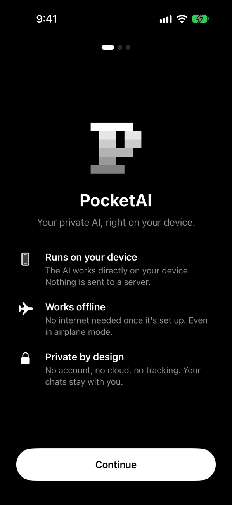
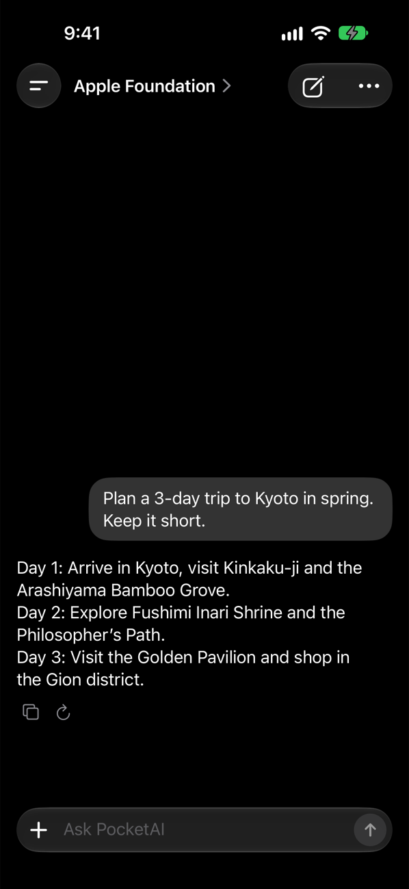
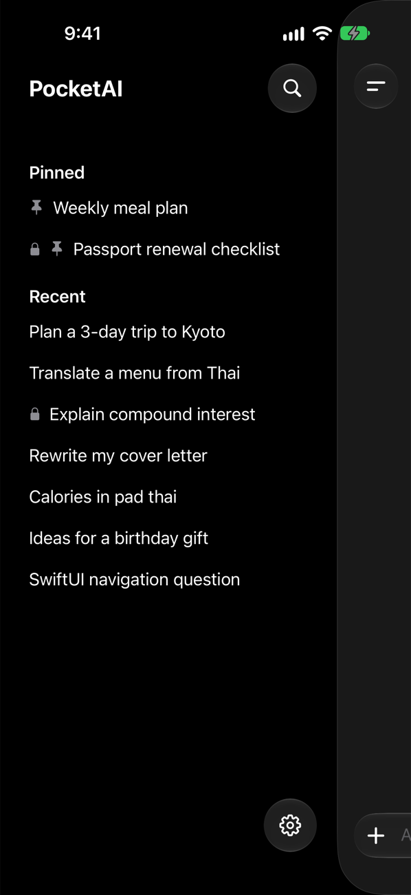
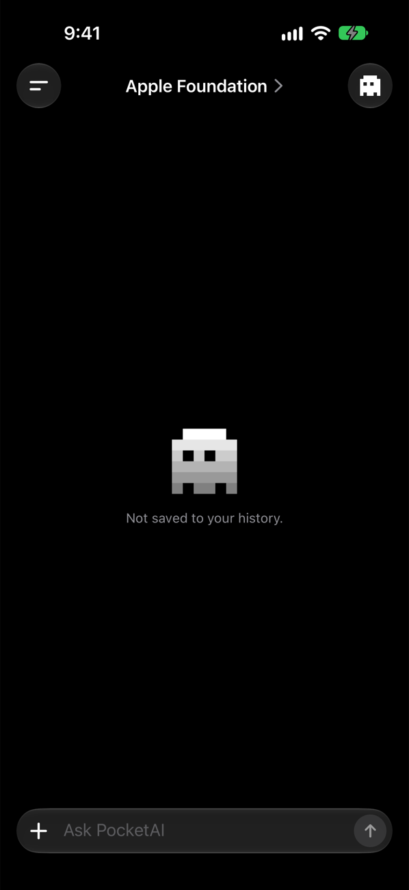
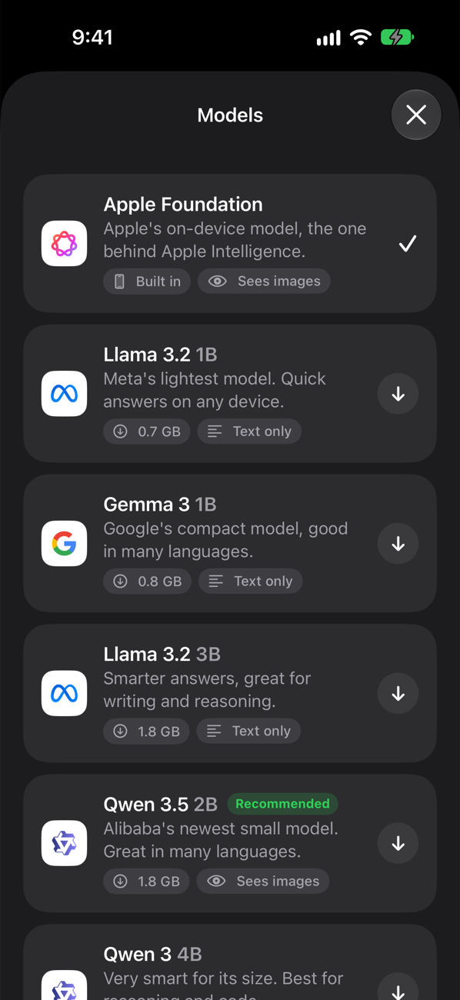
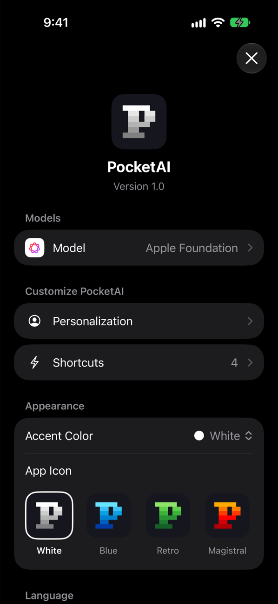

# PocketAI

## Description
PocketAI is a private AI chat app for iPhone and iPad. Every model runs directly on the device, so it works offline, needs no account and your chats never leave your phone. Built with SwiftUI, Apple's Foundation Models framework and [MLX Swift](https://github.com/ml-explore/mlx-swift-lm).

    

    

## Features
- **On-device models** — Apple Foundation (Apple Intelligence) built in, plus downloadable MLX models: Llama 3.2, Gemma 3, Gemma 4, Qwen 3 and Qwen 3.5. Qwen 3.5 2B is recommended as the best balance of size and smarts.
- **Custom models** — Paste any MLX model ID or link from Hugging Face to add it.
- **Images and files** — Send photos, take a picture with the camera, or attach PDFs and text files. Vision models can read images.
- **Shortcuts** — One-tap tasks above the keyboard: Concise, Translate, Calories, Extract Text. Create your own, or let the AI write one for you.
- **Personalization** — Reply style, emoji use, custom instructions and memories the AI always keeps in mind.
- **Chat history** — Pin your important chats and lock private ones with Face ID.
- **Temporary chats** — Tap the ghost to start a chat that isn't saved to your history.
- **Customization** — Accent colors and alternate app icons.
- **Localized** — Available in 21 languages.

## Important Notes
Llama, Gemma and Qwen models are made by Meta, Google and Alibaba and are downloaded from Hugging Face under their own licenses. The license for this project applies only to the source code.

More of my work: [pascaljesenberger.com](https://pascaljesenberger.com/)
